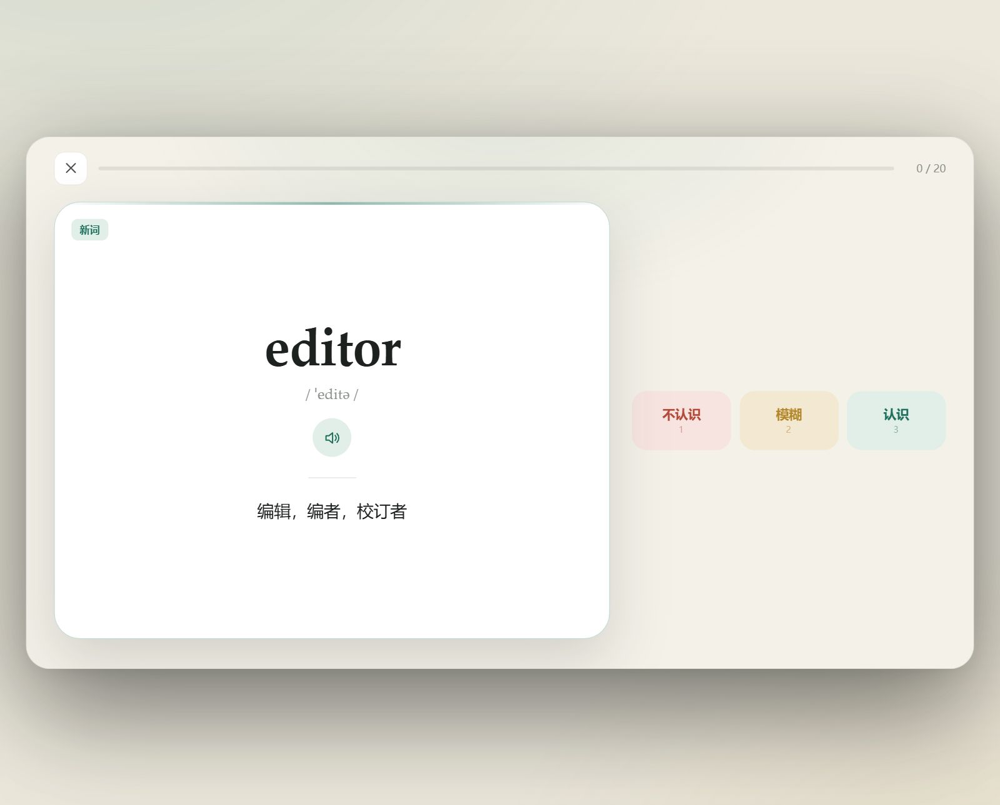
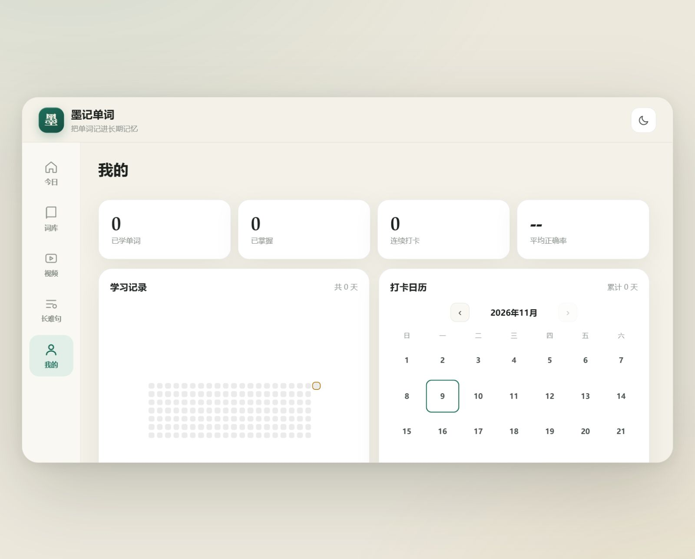

# 墨记单词

一款类似「墨墨背单词」的本地英语学习应用：单词 + 长难句 + 视频字幕 + 主动测验 + 间隔重复 + 打卡统计。纯前端，无需安装环境，双击即用。


[](LICENSE)


> **在线体验**：<https://ychengnb666-lang.github.io/moji-word/> ，手机和电脑都能直接打开，也可以安装成桌面 / 手机 App。

## 界面预览

| 今日学习 | 单词卡片 |
| :---: | :---: |
|  |  |



## 快速开始

**方式一：直接打开**

双击 `index.html`，用 Edge / Chrome 打开即可。所有功能（发音、学习记录）都能用，数据保存在浏览器本地。

**方式二：安装成桌面 App（推荐）**

1. 右键 `start.ps1` →「使用 PowerShell 运行」
2. 浏览器会自动打开 `http://localhost:5173`
3. 在 Edge 地址栏右侧点「安装应用」/ Chrome 菜单 →「安装 墨记单词」

安装后会像原生 App 一样有独立窗口和桌面图标，并且离线可用。

> 如果 PowerShell 提示禁止运行脚本，在终端执行一次：
> `Set-ExecutionPolicy -Scope CurrentUser RemoteSigned`

## 功能

- **真实词库**：CET-4（4540 词）、CET-6（2219 词）、考研（5392 词）、雅思（3427 词）、托福（4510 词）、专八（3866 词），含音标与释义
- **SM-2 间隔重复**：按记忆曲线安排复习，认识 / 模糊 / 不认识三档反馈
- **测验中心**：看英选中、看中选英、听音选词、拼写挑战四种题型，支持 10 / 20 题与键盘作答
- **错题本**：答错的词自动收进错题本，并提前进入复习队列，可随时专项重练
- **生词本**：任意单词一键收藏，词库页按「生词本 / 学习中 / 已掌握 / 未学」筛选
- **单词笔记**：给每个词记下词根、易混词或自己造的句子，学习卡片与详情页同步显示
- **成就徽章 + 周报**：12 枚成就徽章，近 7 天学习次数、正确率与每日柱状图
- **长难句拆解**：18 个精选长句，按主干、从句、修饰、状语分色标注，配翻译与结构讲解
- **视频学习**：导入 YouTube、本地视频或字幕，点句跳转、点词查词、一键加入视频生词本
- **学习方向切换**：英→中 / 中→英
- **每日计划**：每日新词从整个词库随机抽取，覆盖 A–Z，不会总从 A 开头
- **每日打卡**：学完词后一键打卡，记录连续天数、近 7 天状态与月度打卡日历
- **学习统计**：热力图、正确率、已掌握词数、累计学习天数
- **发音**：调用系统语音，支持美音 / 英音
- **深色模式**：跟随系统或手动切换
- **桌面 16:9 布局**：电脑上自动切换为 16:9 悬浮画布 + 左侧导航的双栏界面，手机上保持竖屏单列
- **词库导入**：支持 CSV / JSON 导入自己的词表
- **备份迁移**：一键导出 / 恢复学习数据

## 每日打卡

- 当天至少学过 1 个词，就能在「今日」页点「今日打卡」
- 测验答题同样计入当天学习，只做测验也能完成打卡
- 完成一组学习后，结算页也会出现打卡按钮
- 首页显示连续打卡天数与最近 7 天状态
- 「我的 → 打卡日历」可以按月查看打卡记录和累计天数
- 连续天数按自然日计算，断一天会重新开始

## 导入词库格式

CSV（每行一个词，逗号或 Tab 分隔）：

```csv
abandon,əˈbændən,vt. 放弃；抛弃
ability,əˈbiliti,n. 能力
```

也支持 JSON：

```json
[
  { "w": "abandon", "p": "əˈbændən", "m": "vt. 放弃；抛弃" }
]
```

## 用视频背单词

底部「视频」标签（电脑端为左侧导航）里有三种添加方式：

### 1. YouTube

粘贴视频链接（支持 `watch?v=`、`youtu.be`、`Shorts`），应用会尝试自动抓取英文字幕。

- 抓取失败通常是网络或 CORS 限制，点播放页的「字幕 → 选择字幕文件」，导入 SRT / VTT 即可
- YouTube 字幕下载：可用浏览器扩展，或在视频页打开字幕面板后复制

### 2. 本地视频

选择视频文件，再选择配套的 `.srt` / `.vtt` 字幕，即可实现完整同步：

- 自动高亮当前句，点句子跳转，点单词查词
- 刷新页面后浏览器会出于安全限制释放文件，重新点「重新选择视频文件」选择同一个文件即可

### 3. 仅字幕（Netflix 等）

Netflix 网页受 DRM 保护，任何网页都不能直接嵌入其播放器。请：

1. 用浏览器扩展导出 Netflix 字幕（SRT / VTT）
2. 在「视频 → 仅字幕」里粘贴字幕或选择文件
3. 在 Netflix 里正常播放，在这里按句学习；点句子会用系统语音朗读

### 视频学习交互

- **点字幕**：视频跳到该句（仅字幕模式则朗读该句）
- **点单词**：查看释义，可「加入视频生词本」，之后在「词库」里切换过去学习
- **勾选圆圈**：标记这句已学，右上角显示进度
- **一句一停**：每句结束自动暂停，方便跟读
- **只显示未学**：隐藏已学句子
- **导入中文字幕**：英文字幕已有时，再导入一份中文字幕，会按时间轴自动对齐

## 项目结构

```
index.html            页面骨架
css/style.css         样式（含深色模式）
js/words.js           内置词库数据（CET-4 / CET-6 / 考研，约 900KB）
js/words-extra.js     额外词库（雅思 / 托福 / 专八，约 900KB）
js/data.js            例句、长难句语料
js/store.js           localStorage + SM-2 算法 + 打卡 + 视频数据
js/quiz.js            测验中心：四种题型、错题重练
js/app.js             交互逻辑
js/video.js           视频播放、字幕解析、YouTube 抓取
manifest.webmanifest  PWA 配置
sw.js                 离线缓存
start.ps1             本地静态服务器
icons/                应用图标
```

## 数据说明

- 学习数据只保存在当前浏览器的 `localStorage` 中，不会上传
- 换浏览器 / 换设备前，请在「我的 → 导出备份」保存 JSON
- 清除浏览器数据会丢失学习记录

## 词库来源

词库数据来自开源项目 [mahavivo/english-wordlists](https://github.com/mahavivo/english-wordlists) 与 [ALILIYES/English-word-dataset-and-reptile](https://github.com/ALILIYES/English-word-dataset-and-reptile)，仅供个人学习使用。

## 开源协议

本项目基于 [MIT License](LICENSE) 开源：你可以自由使用、修改、分发，甚至用于商业项目，只需保留版权声明。

词库与例句数据来自第三方开源项目，版权归各自作者所有，详见下方「词库来源」。

## 后续可扩展

- 云同步（Supabase / Firebase）
- 词根词缀与助记内容
- 学习小组 / 排行榜
- 打包为安卓 / iOS 安装包（Capacitor）
